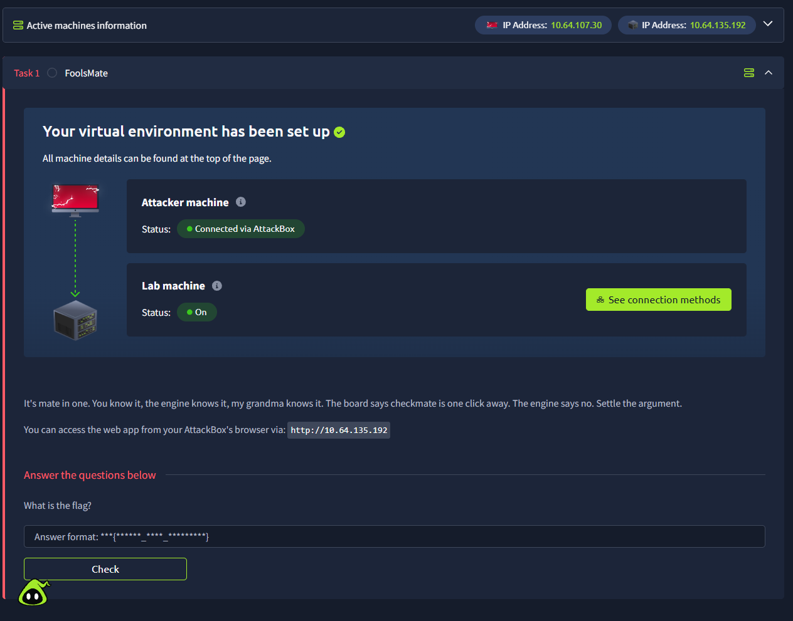
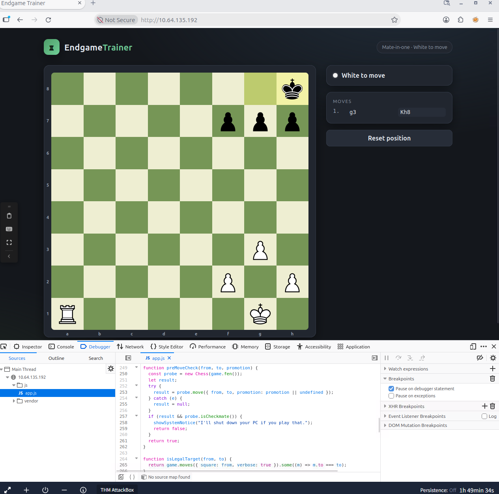
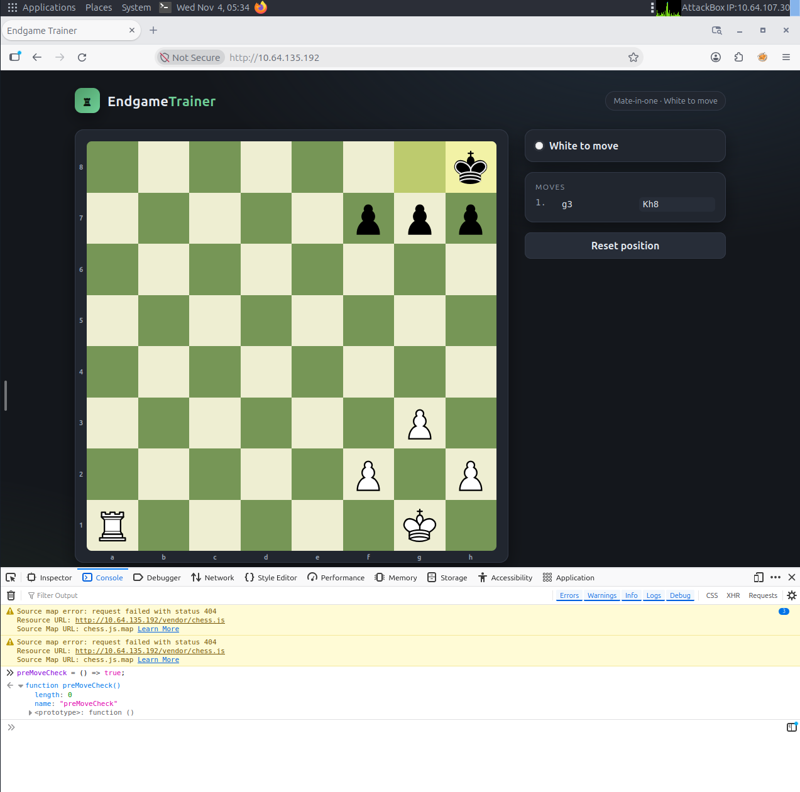
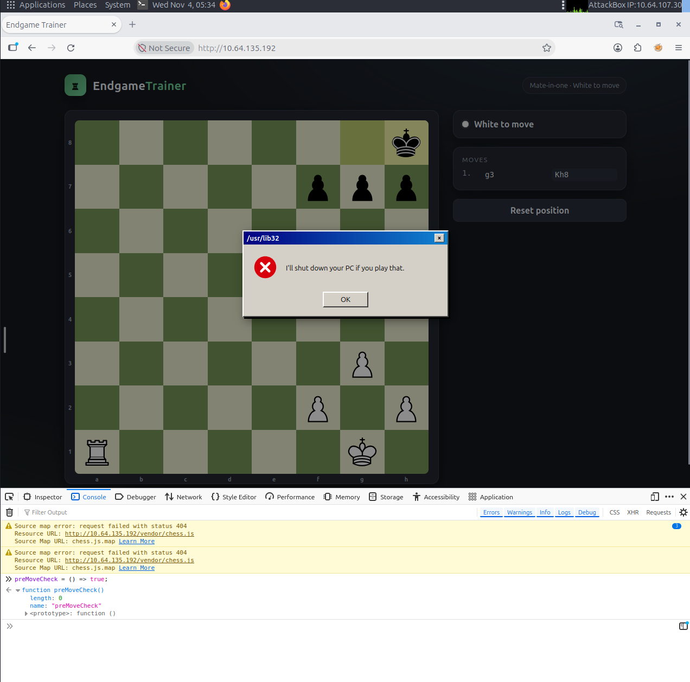
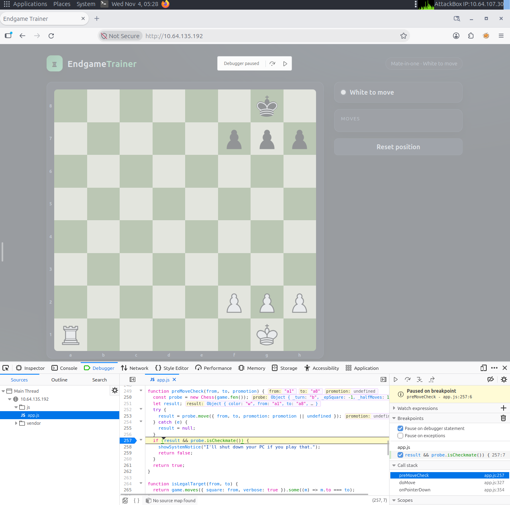
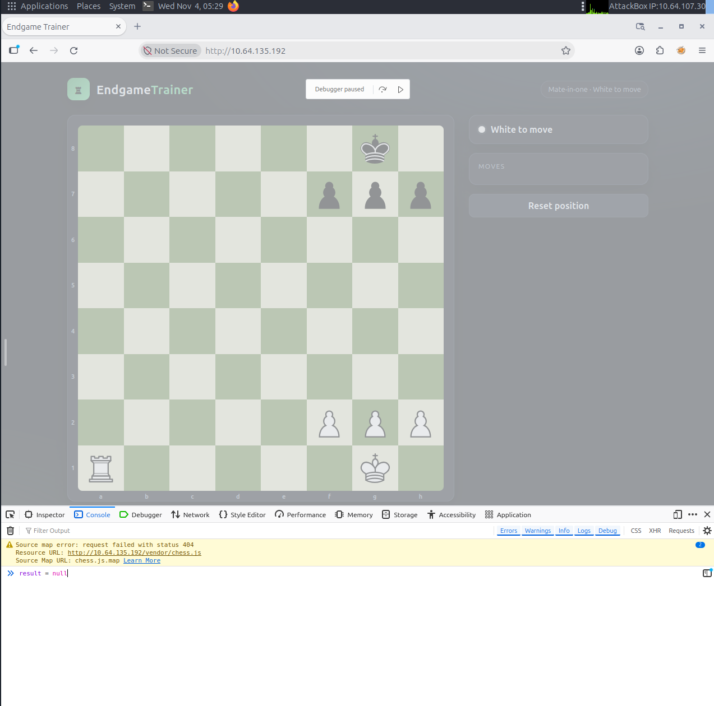
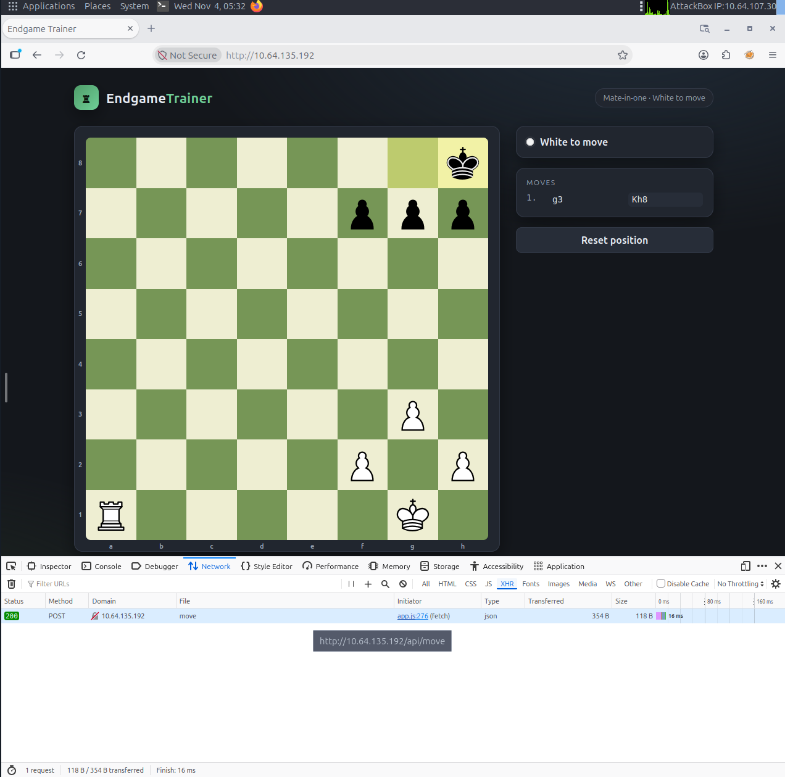
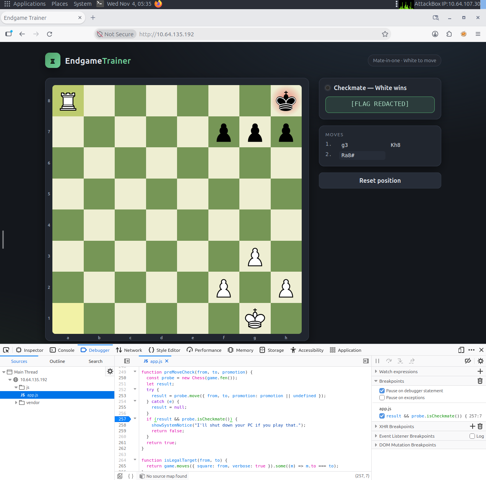

# TryHackMe: Fools Mate

> **Portfolio write-up | Spoilers:** This page describes the solution technique. The challenge flag is intentionally omitted from the report and redacted in screenshots.

| Field          | Details                                                                   |
| -------------- | ------------------------------------------------------------------------- |
| Platform       | TryHackMe                                                                 |
| Lab            | Fools Mate – EndgameTrainer                                               |
| Date completed | November 4, 2026                                                          |
| Focus          | Client-side JavaScript validation bypass                                  |
| Tools          | TryHackMe AttackBox, Firefox Developer Tools (Debugger, Console, Network) |
| Result         | Completed – checkmate accepted and flag obtained                          |

## Objective

Investigate a chess training web application that refuses a winning move. Determine how the checkmate restriction is implemented, bypass it within the authorized lab environment, and capture the flag.

**Result:** The intended winning move, **`Ra8#`** (white rook from a1 to a8), was accepted after modifying a local JavaScript variable at a debugger breakpoint.

## Walkthrough and Evidence

### 1. Start the Lab and Identify the Target

I launched both TryHackMe virtual machines: the AttackBox (attacker workstation) and the lab machine (target web server).  Opened the EndgameTrainer web application from the AttackBox browser. The assigned target IP in this session was `10.64.135.192` (a temporary, private lab address).



### 2. Find the Checkmate-Blocking Function

The application offered a mate-in-one position. Attempting `Ra8#` produced a warning rather than allowing the move. I opened Firefox **Developer Tools -> Debugger**, expanded **`js/app.js`**, and identified the function `preMoveCheck(from, to, promotion)`.

The function simulates a candidate move on a temporary chess object and rejects it if the resulting position is checkmate:

```javascript
if (result && probe.isCheckmate()) {
    showSystemNotice("I'll shut down your PC if you play that.");
    return false;
}
return true;
```

The condition uses two checks:

- `result` determines whether the simulated move succeeded.
- `probe.isCheckmate()` determines whether the simulated move results in checkmate.

When both conditions are true, the application displays a warning and returns `false`, preventing the move.



### 3. Attempt a Simple Console Override (Unsuccessful)

I initially tried replacing the function in the Firefox Console:

```javascript
preMoveCheck = () => true;
```

The intention was to force the function to return `true`, bypassing the checkmate restriction.

The Console displayed the new function, but the web application still showed the warning on the next checkmate attempt. This confirmed that a global reassignment was not sufficient in this interaction. I did not determine precisely why the application's handler still invoked the original logic.





### 4. Pause Execution at the Blocking Condition

After the initial attempt failed, I switched to runtime debugging.

In **Debugger → `app.js`**, I set a breakpoint on the condition at **line 257**:

```javascript
if (result && probe.isCheckmate())
```

I then attempted `Ra8#` again. Firefox paused execution before evaluating the condition.The paused state showed the attempted move from `a1` to `a8`, providing access to the function's local variables.



### 5. Modify the Local Variable and Resume Execution

While execution was paused, I switched to the Firefox Console and entered:

```javascript
result = null
```

The Console returned `null`, confirming the assignment.

Why this worked:

The original condition was:

```javascript
if (result && probe.isCheckmate())
```

In JavaScript, `null` evaluates to `false` in a Boolean context.

Setting `result = null` caused the application to skip the rejection branch because the first condition was false.

As a result, execution continued to:

```javascript
return true;
```

I pressed then resumed execution. This changed the temporary pre-move check, it did not modify the chessboard directly.



### 6. Observe Application Network Traffic

During a separate interaction, I inspected the application's network traffic using **Firefox Developer Tools -> Network -> XHR**.

The browser recorded an HTTP request:

- **Method:** POST
- **Endpoint:** `/api/move`
- **Response status:** 200 OK
- **Initiator:** `app.js`

This confirmed that the chess application communicates with a backend API to process moves.

**Evidence limitation:** The screenshot does not show the request/response body or prove that this particular request was the winning move. Therefore, I do not treat it as independent evidence that the server lacked validation.



### 7. Verify Successful Exploitation

After resuming the paused execution, the application accepted the previously blocked move:

**`Ra8#` Rook to a8, checkmate.**

The interface displayed:

**"Checkmate - White wins"**

The challenge flag appeared, confirming successful lab completion. The flag has been redacted from the screenshot to avoid publishing the answer.



## Technical Finding

### Vulnerability: Client-Side Logic Bypass

**Observed issue:**

A checkmate restriction was enforced by a JavaScript condition in the user's browser. By pausing execution and modifying a local variable, I successfully bypassed the client-side restriction.

### Root Cause

The application used client side JavaScript logic to control whether a move could proceed. Because browser side JavaScript executes in an environment controlled by the user, its execution and state can be manipulated using browser debugging tools.

### Security Implications

This exercise demonstrates the risks of relying on client-side checks as security controls. In real world applications, similar weaknesses can affect:

- Input validation
- Business logic restrictions
- Workflow enforcement
- Access to restricted functionality
- Transaction and approval processes

### Recommended Remediation

Security sensitive rules should be enforced on the backend using authoritative validation.

Client side validation may remain in place to improve usability and provide immediate feedback, but it should not be the sole mechanism protecting application functionality.

### Scope and Limitations

This lab demonstrated a client side logic bypass. I did not perform a separate assessment of the server's authorization or input validation implementation, and I am not claiming a verified production backend vulnerability.

## Skills Demonstrated

- **JavaScript source analysis:** Identifying application logic responsible for enforcing restrictions.
- **Browser debugging:** Using breakpoints to inspect and control JavaScript execution.
- **Runtime manipulation:** Modifying local variables while code execution is paused.
- **Troubleshooting:** Evaluating an unsuccessful technique and selecting an alternative approach.
- **Network inspection:** Identifying browser to server API interactions.
- **Security analysis:** Understanding client-side trust boundaries and their limitations.
- **Technical documentation:** Recording findings, evidence, limitations, and remediation recommendations.

## Lessons Learned

This challenge demonstrated how understanding application logic can reveal opportunities to bypass restrictions without complex exploitation tools.

The most important takeaways were:

1. **Client side restrictions are not trustworthy security boundaries.** A user can inspect and manipulate JavaScript execution within their browser.

2. **Debugging tools are valuable security testing tools.** Browser Developer Tools provide visibility into application logic, runtime variables, and network communication.

3. **Failed attempts provide useful information.** The unsuccessful function override motivated further investigation and the use of a debugger breakpoint.

4. **Execution flow matters.** Understanding where and when a validation condition runs can reveal opportunities to alter its behavior.

5. **Accurate evidence is essential.** Security findings should distinguish what was directly demonstrated from what remains unverified.

## Conclusion

Successfully completed the TryHackMe Fools Mate challenge by identifying and bypassing client side JavaScript validation through Firefox Developer Tools. The exercise reinforced the importance of server side validation, runtime analysis, and methodical security testing. It also provided practical experience with techniques relevant to web application penetration testing and application security assessment.

---

*This exercise was performed exclusively within an authorized TryHackMe training environment. Temporary IP addresses and challenge flags are not reusable outside the lab session.*
